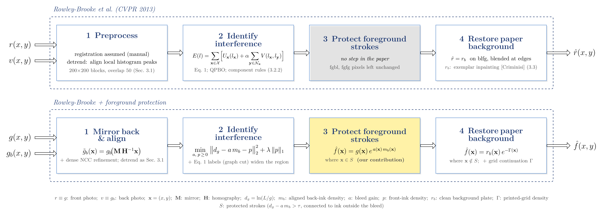

# Bleed-through removal

**Problem:** Sharpie on the back of a page bleeds through to the front. We remove it using a photo of each side, keeping everything else as photographed, including front writing that passes under the bleed.

**Approach:** We built on Rowley-Brooke et al., CVPR 2013 ([paper](https://www.cv-foundation.org/openaccess/content_cvpr_2013/papers/Rowley-Brooke_A_Non-parametric_Framework_2013_CVPR_paper.pdf)) and added one step: **stroke protection**.



## How it works

1. **Align** the back photo to the front (mirror, then match features).
2. **Find the bleed.** Label each pixel as paper, front ink, bleed, or both, as in the paper.
3. **Protect front strokes** (our addition). The paper erases any front ink that is fainter than the bleed, so pencil or pen under Sharpie disappears. We detect those strokes and keep them, removing only the bleed's darkening.
4. **Fill in** the remaining bleed with paper texture, continuing the printed grid lines underneath.

Pixels with no bleed are left exactly as they were.

## Run

From the repo root:

```sh
uv run bleed/recover_overlap.py bleed/samples/pencil-sheet08/front.jpg bleed/samples/pencil-sheet08/back.jpg
uv run bleed/eval_protection.py    # stroke-protection test (~15 min)
uv run bleed/synthetic_inks.py --sheets sheet01 sheet03   # other ink colours (~25 min)
uv run bleed/evaluate_pair.py      # OCR score
uv run python -m unittest discover -s bleed -p 'test_*.py'
```

Outputs go to `bleed/outputs/`. Saved results are in `bleed/results/`.

| Output | What it is |
| --- | --- |
| `minimal.png` | **Our result** (default) |
| `rowley_brooke.png` | The paper's method, for comparison |
| `minimal_protection_off.png` | Ours without stroke protection |
| `recovered_clean.png` | Ink redrawn on white, for OCR only |

## Results (sheet 08)

We pasted real pencil strokes under real Sharpie bleed, then checked how much pencil survived.

| Method | Pencil kept under bleed | Bleed left | OCR character error |
| --- | ---: | ---: | ---: |
| Raw photo | – | – | 93.8% |
| Rowley-Brooke 2013 | 7.6% | 9.9% | 55.5% |
| **Ours** | **59.4%** | **11.6%** | **40.6%** |

- **Stroke protection keeps about 8× more pencil** and cuts character errors by about a quarter.
- Pencil outside the bleed is never changed.
- **The cost:** slightly more bleed is left behind, and word error is still a bit higher than the paper's, because recovered words are mostly but not exactly right.

**Other inks:** on a synthetic test with pencil, blue pen, red pen and black marker, the paper erases about half of pen and pencil under the bleed. Ours keeps it.

## Limits

- Tested on one real page, and settings were tuned on that page.
- Bleed texture inside solid Sharpie can't be predicted from the back photo; this causes most of our errors.
- Front inks that also bleed through (marker, felt-tip) aren't handled.
- Much lighter pencil on another page might not be protected.
- The DE-GAN (deep learning) branch is not implemented yet.
