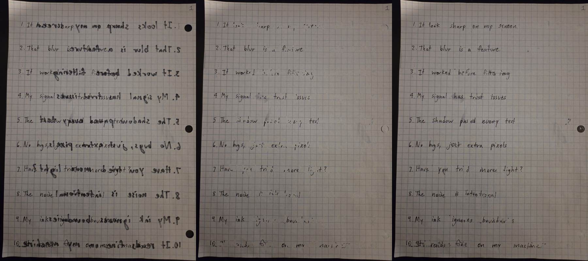
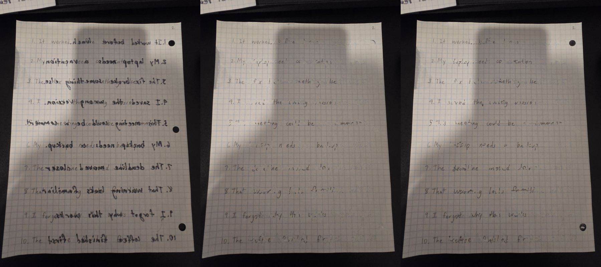
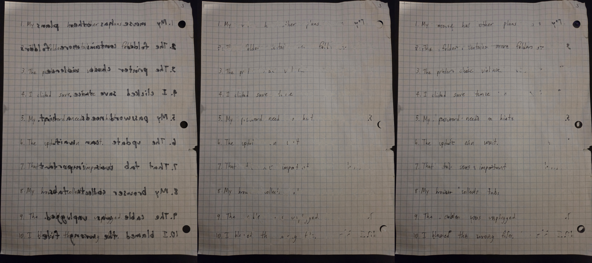
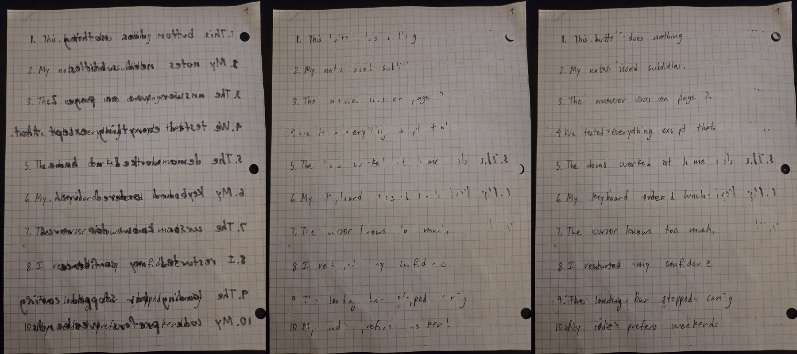
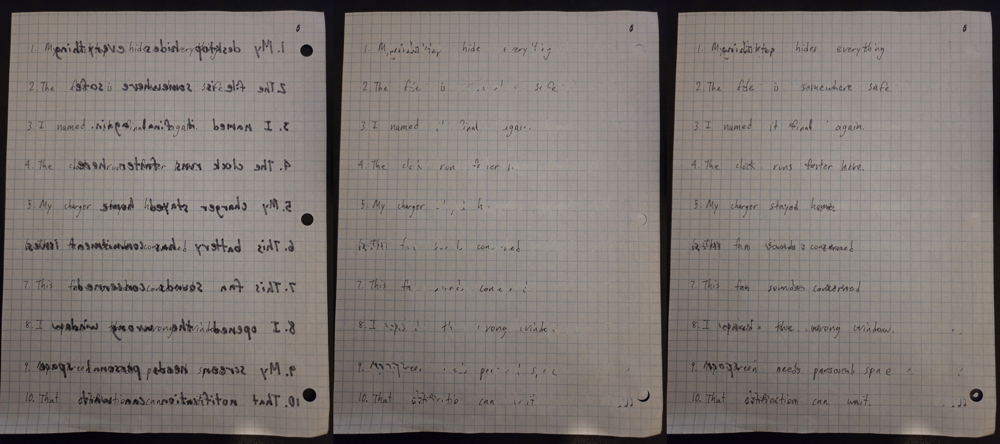
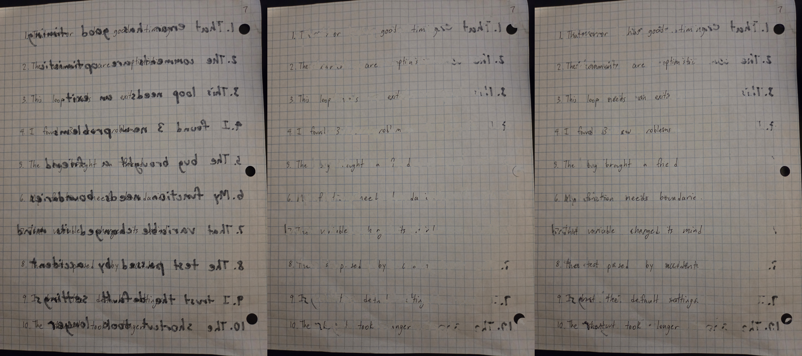
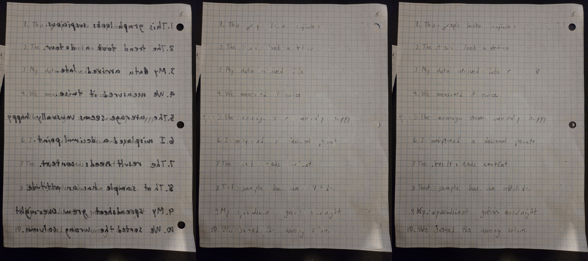
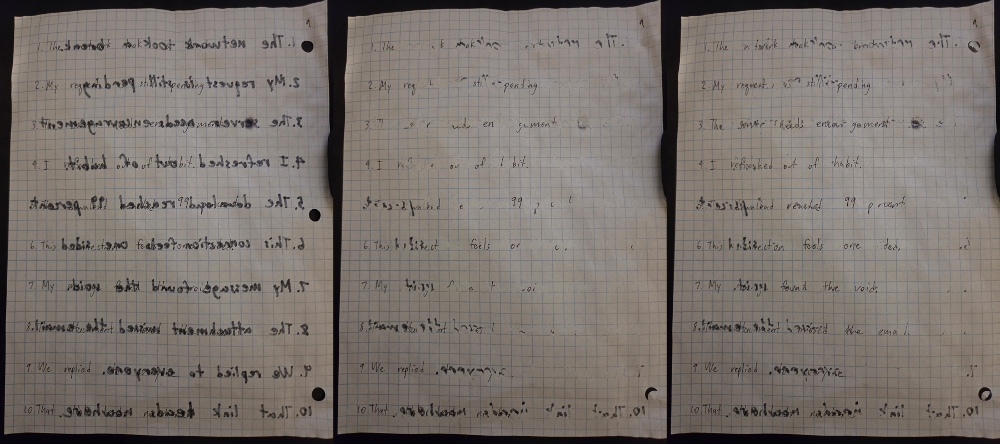
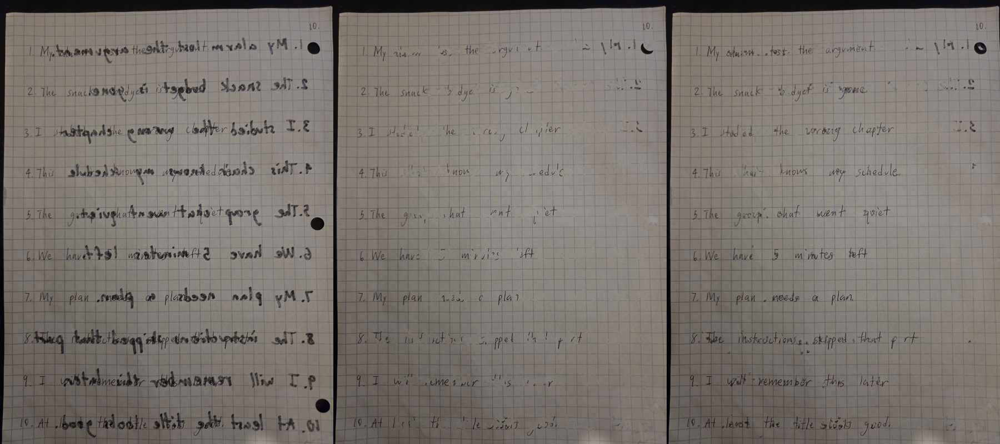

# Improved method across the November dataset

Attempted 31 captures. Completed 28; failed 3.

| Method | Normalized CER | Normalized WER | Exact lines |
| --- | ---: | ---: | ---: |
| input | 98.71% | 122.40% | 0/280 |
| rowley_brooke | 53.58% | 78.98% | 3/280 |
| minimal_protection_off | 56.90% | 83.10% | 4/280 |
| minimal | 26.78% | 45.34% | 47/280 |

CER/WER above pool character/word edits over identical crops on successfully processed captures. Failed pairs are excluded from every variant.

## Per-image CER

| Capture | Raw | Baseline | Protection off | Improved |
| --- | ---: | ---: | ---: | ---: |
| sheet01/front-01 | 78.04% | 32.16% | 51.76% | 11.37% |
| sheet01/front-02 | 70.98% | 43.53% | 54.51% | 19.61% |
| sheet01/front-03 | 79.61% | 72.16% | 65.49% | 47.45% |
| sheet02/front-01 | 97.66% | 59.38% | 57.03% | 37.11% |
| sheet02/front-02 | 100.00% | 80.47% | 88.28% | 79.69% |
| sheet02/front-03 | 102.34% | 61.72% | 65.23% | 48.44% |
| sheet03/front-01 | 78.06% | 41.35% | 45.57% | 17.30% |
| sheet03/front-02 | 85.65% | 43.04% | 58.65% | 18.14% |
| sheet03/front-03 | 81.01% | 46.41% | 45.15% | 15.61% |
| sheet04/front-01 | 108.24% | 62.75% | 65.88% | 17.25% |
| sheet04/front-02 | 104.31% | 52.55% | 52.16% | 15.69% |
| sheet04/front-03 | 96.86% | 59.61% | 68.63% | 20.39% |
| sheet06/front-01 | 96.46% | 47.24% | 44.88% | 21.65% |
| sheet06/front-02 | 102.76% | 43.31% | 41.73% | 9.84% |
| sheet06/front-03 | 107.48% | 40.16% | 45.67% | 14.17% |
| sheet06/front-04 | 99.61% | 44.88% | 50.00% | 8.66% |
| sheet07/front-01 | 110.81% | 71.43% | 52.12% | 24.32% |
| sheet07/front-02 | 126.25% | 48.26% | 65.25% | 17.37% |
| sheet07/front-03 | 112.74% | 50.97% | 66.02% | 26.64% |
| sheet08/front-01 | 96.88% | 52.73% | 51.17% | 30.86% |
| sheet08/front-02 | 102.73% | 48.05% | 48.44% | 37.11% |
| sheet08/front-03 | 95.31% | 50.39% | 54.69% | 32.81% |
| sheet09/front-01 | 104.85% | 72.39% | 72.01% | 48.51% |
| sheet09/front-02 | 97.01% | 64.18% | 58.96% | 31.72% |
| sheet09/front-03 | 103.73% | 55.97% | 55.60% | 21.27% |
| sheet10/front-01 | 107.66% | 49.43% | 52.87% | 21.07% |
| sheet10/front-02 | 100.77% | 47.13% | 55.17% | 24.14% |
| sheet10/front-03 | 110.73% | 54.79% | 57.47% | 28.35% |

## Failures

- sheet05/front-01: Unreliable registration; do not use reverse-side guidance.
- sheet05/front-02: Unreliable registration; do not use reverse-side guidance.
- sheet05/front-03: Unreliable registration; do not use reverse-side guidance.

## Scope

Fixed pilot-selected settings, provisional labels, repeated captures. Baseline shares improved registration, labels and plate. No clean target for pixel preservation scores. Excluding sheet08 is a sensitivity analysis, not a preregistered held-out test.

Baseline means the repository Rowley-Brooke restoration on shared registration, labels and plate, not a separate run of the original authors' software. The improved output is minimal.png, using recover_overlap.py defaults without new tuning. Protection-off uses the same pipeline with protection disabled.

See summary.json for all diagnostics, source hashes, per-image metrics, and the analysis excluding development sheet08. No synthetic preservation percentages are inferred for these real photos.

[Full local gallery](../../outputs/improved/review.html) | [Summary](summary.json) | [Batch command](../../BATCH.md)

Reproduce: `uv run bleed/run_dataset.py --method improved --ocr`. All 14 existing safeguard tests passed.

### sheet01/front-01: input / matched baseline / improved

### sheet02/front-01: input / matched baseline / improved

### sheet03/front-01: input / matched baseline / improved

### sheet04/front-01: input / matched baseline / improved

### sheet06/front-01: input / matched baseline / improved

### sheet07/front-01: input / matched baseline / improved

### sheet08/front-01: input / matched baseline / improved

### sheet09/front-01: input / matched baseline / improved

### sheet10/front-01: input / matched baseline / improved

